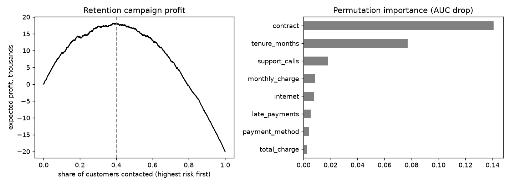

# telecom-churn-pipeline

End-to-end churn model: sklearn pipeline, cross-validation, permutation importance, campaign profit and a saved model.

## Task

Predict who will leave and choose how many customers to contact so that a retention campaign pays off.

## Approach

- Telecom customers with contract, internet type, charges, tenure, support calls and payment features.
- All preprocessing sits inside one `Pipeline`, so scaling and encoding are fitted only on training folds; unseen categories are handled.
- Logistic regression, random forest and gradient boosting are compared by five-fold ROC AUC.
- `campaign_profit_curve` turns probabilities into expected profit for contacting the top share of customers; the best size is picked from it.
- The fitted pipeline is saved with joblib and reloaded in the tests.

## Results



- 12,000 customers, churn rate 37%.
- Cross-validated AUC: logistic 0.797, gradient_boosting 0.793, random_forest 0.791.
- Best model `logistic`, test AUC 0.781. Top features: contract, tenure_months, support_calls, monthly_charge.
- The campaign is most profitable when contacting the riskiest 40% of customers (expected profit 18,140 on the test set).

## Run

```bash
pip install -r requirements.txt
python run.py      # generates data, runs the analysis, writes reports/
pytest             # unit tests
```

## Layout

```
src/data.py     data generation (fixed seed, no downloads)
src/core.py     analysis / model code
run.py          end-to-end script
tests/          unit tests
reports/        figures and summary.json produced by run.py
```

## Notes

The data is generated by `src/data.py` with a fixed random seed, so the numbers above are reproducible. It is synthetic: it is meant to show the method, and results on real data will differ.

Stack: pandas, scikit-learn, joblib, matplotlib.
